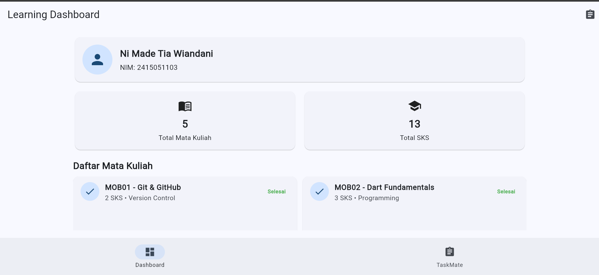
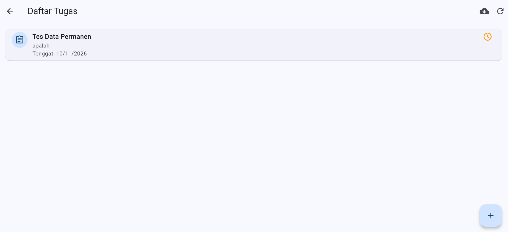
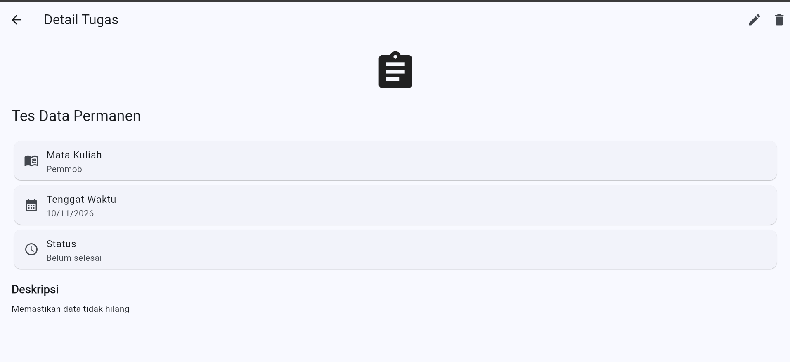
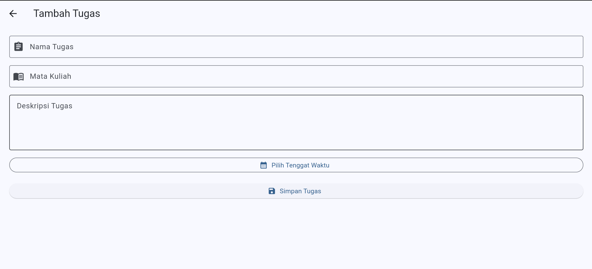
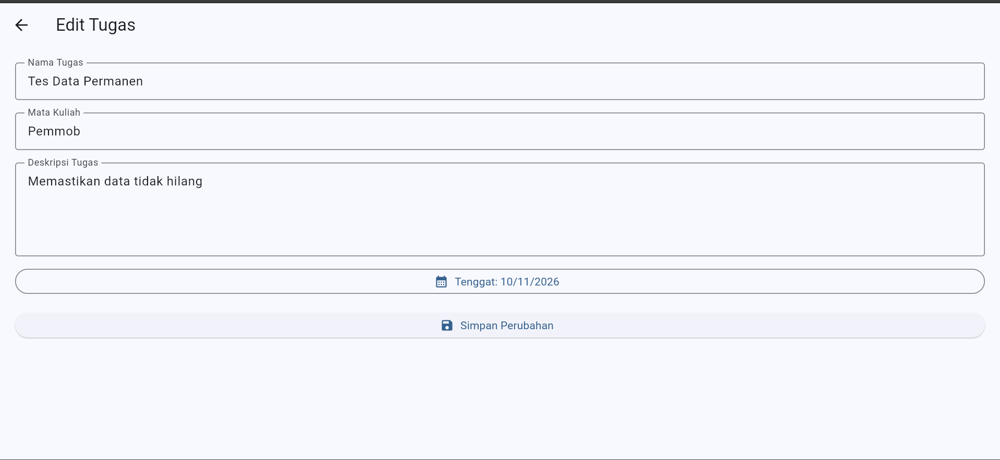
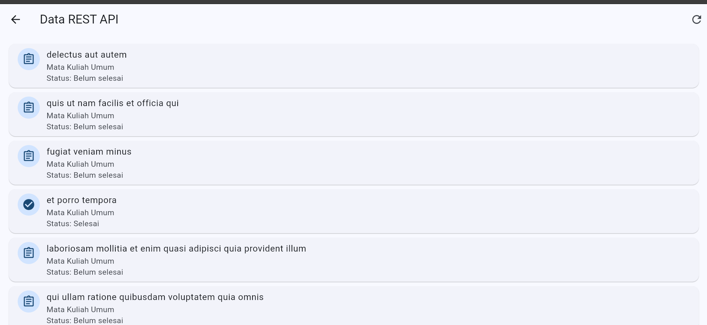
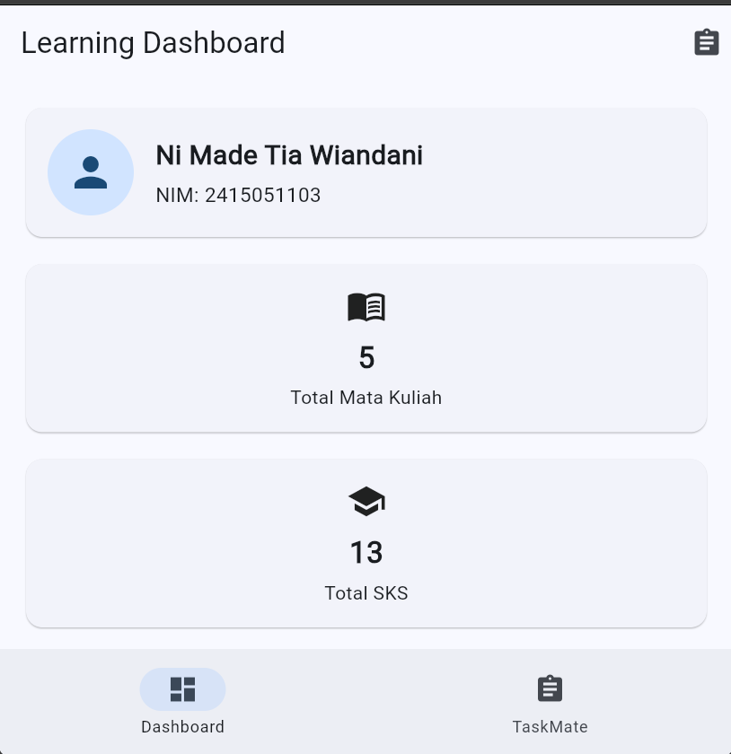

# TaskMate – Aplikasi Manajemen Tugas Mahasiswa

## Identitas Mahasiswa

- Nama: Ni Made Tia Wiandani
- NIM: 2415051103
- Kelas: 5B
- Program Studi: Pendidikan Teknik Informatika
- Universitas: Universitas Pendidikan Ganesha

## Deskripsi Proyek

TaskMate merupakan aplikasi manajemen tugas mahasiswa berbasis Flutter yang dikembangkan untuk memenuhi tugas Ujian Tengah Semester (UTS) Pemrograman Mobile.

Aplikasi ini membantu mahasiswa mengelola tugas perkuliahan melalui fitur tambah, lihat, edit, dan hapus tugas. Data disimpan secara permanen menggunakan Supabase.

## Fitur Aplikasi

1. Dashboard profil mahasiswa.
2. Menampilkan daftar tugas.
3. Menambahkan tugas baru.
4. Melihat detail tugas.
5. Mengedit informasi tugas.
6. Menghapus tugas dengan konfirmasi.
7. Mengambil data REST API JSONPlaceholder.
8. Penyimpanan permanen menggunakan Supabase.
9. Validasi formulir.
10. Notifikasi SnackBar dan Dialog.
11. Tampilan responsif.
12. Navigasi menggunakan NavigationBar.

## Teknologi yang Digunakan

- Flutter dan Dart
- Provider dan ChangeNotifier
- Supabase dan PostgreSQL
- REST API JSONPlaceholder
- Git dan GitHub

## Arsitektur Aplikasi

Proyek menggunakan pemisahan tanggung jawab berdasarkan folder:

```text
lib/
├── models/
├── providers/
├── repositories/
├── screens/
├── services/
├── widgets/
└── main.dart
```

Alur pengelolaan data:

UI → Provider → Repository → Service / Database

## State Management

Pengelolaan state menggunakan Provider dan ChangeNotifier untuk mengelola data tugas, proses loading, dan perubahan data aplikasi.

## Responsive Layout

Aplikasi menggunakan MediaQuery untuk menyesuaikan tampilan berdasarkan ukuran layar.

Pada layar lebar, daftar mata kuliah ditampilkan menggunakan GridView, sedangkan pada layar sempit menggunakan ListView.

## REST API

Sumber REST API:

https://jsonplaceholder.typicode.com/todos

Aplikasi mengambil data menggunakan HTTP GET, kemudian mengubah JSON menjadi objek Dart Model.

## Database

Backend menggunakan Supabase dengan database PostgreSQL dan tabel `tasks`.

Kolom data:
- id
- title
- course
- description
- due_date
- status
- created_at

Operasi database meliputi Create, Read, Update, dan Delete (CRUD).

## Pengujian Otomatis

Pengujian dilakukan menggunakan Flutter Test.

Pengujian Model meliputi:
- Student.fromJson()
- Task.fromJson()
- Task.toJson()
- Task.copyWith()

Seluruh empat pengujian berhasil dijalankan.

## Repository GitHub

https://github.com/tiawiandani/mobile-praktikum

## Cara Menjalankan Aplikasi

```bash
git clone https://github.com/tiawiandani/mobile-praktikum.git
cd mobile-praktikum
flutter pub get
flutter run
```

Untuk menjalankan melalui Chrome:

```bash
flutter run -d chrome
```

---## Screenshot Aplikasi

Dokumentasi tampilan aplikasi TaskMate:

### 1. Dashboard


### 2. Daftar Tugas


### 3. Detail Tugas


### 4. Tambah Tugas


### 5. Edit Tugas


### 6. REST API


### 7. Tampilan Responsif

Proyek UTS Pemrograman Mobile – TaskMate
